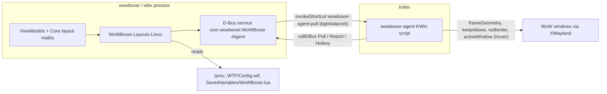

# WoWBoxer for Linux – port plan

WoWBoxer (this repo's Windows app, upstream `WoW-Multiboxing/wowboxer-layouts`) ported to Linux with KDE Plasma 6
(KWin 6, Wayland session). Same product, same look, same rules: it places 1–10 World of Warcraft windows (Wine/Proton
clients) in a layout and keeps them there. It only moves, resizes and restyles windows.

Ported from upstream commit `321114b` (v0.7.1-beta.1). Upstream code is kept unchanged in this repo; the port adds
new projects next to it, so `git merge upstream/main` stays easy.

## Hard rules (the upstream rules, plus Linux)
- **Only moves, resizes and restyles windows.** No keystrokes, mouse events, input hooks, uinput, xdotool key/mouse,
  `ydotool`, round-robin or focus-switch hotkeys. No game memory, no injection, no login automation.
- **Never steal focus.** Setting a window's geometry or keep-above in KWin never activates it; the agent never sets
  `workspace.activeWindow` except for hover to activate (below).
- **Hover to activate** (the upstream exception): on the user's click only, off by default. On Linux it is done by the
  agent, between WoW windows only: while a WoW window is active, resting the pointer on another WoW window for the
  delay makes that one active. It never moves focus to or from another application.
- **Window swap hotkeys** (the second upstream exception): KWin global shortcuts owned by the agent; the key press goes
  to KWin, never to the game. A swap only moves windows. Off by default; no other game-related hotkeys.
- No telemetry, no network calls (the update check is removed on Linux: NixOS deploys updates). Logs stay local.
- No personal data in the repo: no real account, character or user names, no home paths in tests or docs.

## Repo layout (new parts)
| Path | What |
|---|---|
| `WoWBoxer.Layouts.Linux.slnx` | Core, Core.Tests and the Linux projects (the WPF/Win32 projects do not build on Linux) |
| `src/WoWBoxer.Layouts.Linux/` | Backend: the Linux counterpart of `WoWBoxer.Layouts.Win32` (same public type and member names where the app or CLI uses them), D-Bus link to the agent, /proc, umu-run, addon bridge |
| `src/WoWBoxer.Layouts.Linux.App/` | The WPF app ported to Avalonia 12.1.5 (namespace stays `WoWBoxer.Layouts.App`, executable `wowboxer`) |
| `src/WoWBoxer.Layouts.Linux.Cli/` | `wbx` for Linux |
| `tests/WoWBoxer.Layouts.Linux.Tests/` | xunit tests of the backend's pure parts |
| `kwin/wowboxer-agent/` | The KWin script ("the agent"): KPackage with `metadata.json` and `contents/code/main.js` |
| `kwin/tests/` | bun tests of the agent against a stand-in KWin API |
| `flake.nix`, `nix/` | Nix package (buildDotnetModule) |

Upstream files the port reuses unchanged: all of `src/WoWBoxer.Layouts.Core` and `tests/WoWBoxer.Layouts.Core.Tests`,
the fonts and icons in `src/WoWBoxer.Layouts.App/Assets`. Files copied and adapted: the App's `.cs`/`.xaml` (as
`.axaml`), the Win32 layer's logic (SlotKeeper, SquadWatcher, SquadPlan, Arranger …) and the CLI.

## Architecture

- A KWin script cannot offer D-Bus methods, but it can call them (`callDBus`) and run code when one of its global
  shortcuts is invoked. So the **app owns the D-Bus service** and the agent calls it. To make the agent act now, the
  app invokes the agent's shortcut `wowboxer-agent-pull` through kglobalaccel; the agent then calls `Pull`.
- The **app loads the agent** itself (`org.kde.KWin /Scripting loadScript(path, "wowboxer-agent")`, then
  `/Scripting/Script<id> run`) when it is not loaded or reports another version, and unloads it when it quits. No KWin
  configuration is needed. The agent ships next to the app: `<app dir>/kwin/wowboxer-agent/contents/code/main.js`.
- KWin coordinates are **logical pixels** (Plasma's scale applied). The port uses them everywhere a Windows build uses
  physical pixels: `PixelRect` values are KWin logical pixels rounded to integers.

## The agent protocol (version 1)
D-Bus, session bus. The app owns the name **`com.wowboxer.WoWBoxer`**, object **`/Agent`**, interface
**`com.wowboxer.Agent1`**. Every argument and reply is one JSON string (`s`).

| Method | Caller | What |
|---|---|---|
| `Pull(s hello) → s desired` | agent | `hello` = `{"agent":"<version>","epoch":"<epoch last seen>","done":<last action n done>}`. Reply: the desired state below. Called when the agent starts, when `wowboxer-agent-pull` is invoked, and every 5 s as a heartbeat. |
| `Report(s state)` | agent | The state below. Sent at most every 50 ms while things change, and with every heartbeat. |
| `Hotkey(s action)` | agent | A registered shortcut fired: `swap:next`, `swap:previous`, `swap:client:1` … `swap:client:10`, `swap:home`, `show`. |

The app also exports **`/App`**, interface **`com.wowboxer.App1`**, method **`Args(as args)`**: a second `wowboxer`
start hands its arguments to the running one (upstream's single-instance hand-over) and exits.

**Desired state** (`Pull` reply):
```json
{
  "v": 1,
  "epoch": "b3f1…",
  "ownPid": 4242,
  "actions": [
    {"n": 7, "op": "place", "id": "{uuid}", "rect": {"x": 0, "y": 0, "width": 1688, "height": 1392}},
    {"n": 8, "op": "above", "id": "{uuid}", "on": true},
    {"n": 9, "op": "border", "id": "{uuid}", "on": false}
  ],
  "keepAbove": ["{uuid}"],
  "wow": ["{uuid}", "{uuid}"],
  "hover": {"enabled": true, "delayMs": 30, "bringToFront": true},
  "own": [{"caption": "WoWBoxer Identify 1", "rect": {"x": 10, "y": 10, "width": 300, "height": 200}, "above": true, "noBorder": true, "skipTaskbar": true}]
}
```
- `epoch` is new on every app start. When it differs from the one the agent last saw, the agent forgets its `done`
  counter. The agent runs every action with `n > done`, in order, then reports `done`.
- `place` sets `frameGeometry` (the visible window, title bar included, as upstream's "visible edges"). `above` sets
  `keepAbove`. `border` sets `noBorder = !on`. Unknown ops are skipped and logged (`print`).
- `keepAbove` lists windows that must stay above: when Wine clears `keepAbove` (it does, 300–750 ms after a move), the
  agent sets it again at once – at most 20 times in 10 s per window, then it gives up and reports it.
- `wow` is the set hover may switch between. `hover` as upstream's `HoverSettings` (on/off, delay, bring to front).
- `own`: the app's own helper windows (Identify overlays), found by `ownPid` + `caption`; the agent sets their
  geometry, keep-above, border and skip-taskbar whenever they appear or the entry changes.
- An empty `actions`, `keepAbove`, `wow` and `own` with hover off = the agent does nothing (the app is stopped).
- If the app is not running, the agent's calls fail; it keeps its last desired state, and stays quiet.

**State** (`Report`):
```json
{
  "v": 1, "agent": "1.0.0", "epoch": "b3f1…", "done": 9,
  "outputs": [{"name": "DP-1", "manufacturer": "…", "model": "…", "scale": 1.5,
               "geometry": {"x": 0, "y": 0, "width": 2560, "height": 1440},
               "workArea": {"x": 0, "y": 0, "width": 2560, "height": 1392}}],
  "active": "{uuid}",
  "windows": [{"id": "{uuid}", "pid": 1234, "caption": "World of Warcraft", "resourceClass": "wow.exe",
               "resourceName": "wow.exe", "frame": {…}, "client": {…}, "keepAbove": false, "noBorder": false,
               "minimized": false, "fullScreen": false, "moving": false, "output": "DP-1", "stack": 12}],
  "handEdited": [{"id": "{uuid}", "frame": {…}}],
  "gaveUp": ["{uuid}"]
}
```
- `outputs` in Plasma's screen order (`workspace.screenOrder`): the first is the primary. `workArea` is
  `workspace.clientArea(KWin.MaximizeArea, output, currentDesktop)`. Rects are KWin logical pixels.
- `windows`: managed normal windows only (not deleted, not special), in stacking order (`stack` = index).
- `handEdited`: windows the user moved or resized by hand (KWin `interactiveMoveResizeFinished`) since the last report.
  The app treats it like a drag on its map (a preset becomes Custom from exactly that) while placing is started.
- `gaveUp`: windows whose keep-above the agent stopped restoring.

**Shortcuts** the agent registers (`registerShortcut`, component `kwin`): `wowboxer-agent-pull` (no key),
`wowboxer-swap-next`, `wowboxer-swap-previous`, `wowboxer-swap-client-1` … `-10`, `wowboxer-swap-home` (no default
keys: the app sets them with kglobalaccel `setForeignShortcutKeys` when the user applies swap hotkeys, and clears them
when swap hotkeys are off), `wowboxer-show` (default `Meta+Alt+W`: shows the app window).

## Backend: Windows layer → Linux layer
`WoWBoxer.Layouts.Linux` offers the same public types and members as `WoWBoxer.Layouts.Win32` wherever the app or the
CLI uses them, so the ported view models change only their `using`. Window handles stay `nint`: the backend maps each
KWin window id (UUID) to a stable `nint` for the life of the process.

| Upstream (Windows) | Linux |
|---|---|
| `WindowFinder` (EnumWindows, process name `Wow*.exe`, path `\World of Warcraft\`, `GxWindowClass`) | Windows from the agent's last report. A window is a WoW client when its process's `/proc/<pid>/cmdline` names a `Wow*.exe` (Windows path) or its path is inside a `World of Warcraft` folder. `ExePath` = the Linux path: `WINEPREFIX` from `/proc/<pid>/environ` + `drive_c/…`. Order: process start time (`/proc/<pid>/stat`) |
| `WindowFinder.VisibleRectOf` / `RectOf` / `ClientSizeOf` | `frame` / `frame` / `client` size from the report |
| `WindowPlacer.Place` (SetWindowPos, NOACTIVATE) | `place` action (+ `border`, `above`), returns `Requested` / `AlreadyThere` / `Gone` |
| Topmost, `ZOrderGuard` | `above` action + `keepAbove` list (the agent re-asserts) |
| Remove title bars (`WS_POPUP` chrome) | `border` action (KWin `noBorder`) |
| Retitle "WoW - Name" (`WM_SETTEXT`) | `_NET_WM_NAME` and `WM_NAME` of the XWayland window (found by `_NET_WM_PID`) with `xprop` |
| `MonitorReader` (EnumDisplayMonitors, DPI) | `outputs` of the report → `MonitorInfo(index, name, primary, geometry, workArea, dpi = 96 × scale)`, `DeviceId` = output name + model |
| `HoverActivation` (SystemParametersInfo) | the `hover` entry of the desired state; read back from the app's own setting |
| `GlobalHotkeys` (RegisterHotKey, WM_HOTKEY) | agent shortcuts + `Hotkey` calls; keys set with kglobalaccel `setForeignShortcutKeys` (Qt key codes) |
| `ProcessInfo` (elevation, start time, image path) | `/proc`; elevation is always `Normal` |
| `ClientLauncher`, `GameInstall`, `BattleNet` | `umu-run` in the game's Wine prefix (env as faugus-launcher: `WINEPREFIX`, `PROTONPATH`, `GAMEID=umu-default`, `PROTON_ENABLE_WAYLAND=0`, `WINE_SIMULATE_WRITECOPY=1`, `UMU_USE_STEAM=1`, `UMU_CONTAINER_NSENTER=1`), one client after the other |
| `UiScaleFix` | Core's `UiScale`/`WowConfig` on the prefix's `WTF/Config.wtf`; running clients from `/proc` |
| `WindowCapture` (PrintWindow) | KWin `org.kde.KWin.ScreenShot2 CaptureWindow` (needs `X-KDE-DBUS-Restricted-Interfaces` in the desktop file) |
| `Diagnostics` | Linux facts: session type, KWin and agent versions, outputs, windows, WoW processes and prefixes, Config.wtf, the old `wow-multibox` KWin script if loaded |
| `Taskbar.AutoHides` | false (KWin's work area already leaves panels out) |
| `Dpi`, `Sandbox` | `Dpi` not needed; `Sandbox` (demo/screenshot fake windows and monitors) ported as is |

Dev aid (no game needed): `WBX_FAKE_WOW=<caption prefix>` makes the backend treat windows whose caption starts with it
as WoW Forever clients (like upstream's `tools/fakewow`). Example: `xterm -T "FakeWoW 1" &`.

## The addon bridge (upstream backlog item 3, built here)
`docs/classes-and-accounts.md` is the contract. The WoWBoxer AddOn writes `WoWBoxerDB.bridge = {version, character,
realm, class, level, loggedInAt, savedAt}` into `WTF/Account/<ACCOUNT>/SavedVariables/WoWBoxer.lua` when the player
logs out or types `/reload`. The backend reads it (a small read-only Lua table parser, never `lua` itself) and watches
the files (`FileSystemWatcher`). In the squad list, a slot whose account is chosen gets the character's name and class
from it, marked "from the WoWBoxer AddOn", when `savedAt` is newer than the slot's last change. The account → window
link stays the user's choice (no OS signal tells which client runs which account).

## Linux-only UI differences
- Settings › Updates: replaced by one line, "Updates come with your system (NixOS deploy)." No update check.
- Settings › Advanced › swap hotkeys: same UI; "Apply hotkeys" sets the KWin shortcuts.
- Hover to activate: same switch, delay and "Bring window to front when activated"; the text says it is done by
  WoWBoxer's KWin script between WoW windows, and sends nothing to the game.
- "Open Battle.net instead" starts `Battle.net Launcher.exe` in the same Wine prefix.
- Guide/Help texts: Windows-only advice (administrator, SmartScreen, Windows settings) is replaced by the Linux facts
  (Wine prefix, Proton, KDE). Everything else stays word for word.
- A game window moved or resized by hand while placing is started becomes the layout (Custom), as a drag on the map.

## Build, test, run
```
dotnet build WoWBoxer.Layouts.Linux.slnx
dotnet test WoWBoxer.Layouts.Linux.slnx --filter "FullyQualifiedName!~GameDetectionTests.Game_from_install_folder&FullyQualifiedName!~ProfileStoreTests.File_names_are_safe"
bun test kwin/tests
dotnet run --project src/WoWBoxer.Layouts.Linux.App -- --demo
dotnet run --project src/WoWBoxer.Layouts.Linux.App -- --screenshots /tmp/wbx-shots
```
The filter skips upstream tests that only hold on Windows: `Game_from_install_folder` feeds backslash paths (Linux
paths work), and `File_names_are_safe` expects `:` to be replaced (it is a valid file name character on Linux).

## Following upstream
`git fetch upstream && git merge upstream/main`. Core and its tests come along unchanged. For the copied parts, port
what changed: `git diff 321114b..upstream/main -- src/WoWBoxer.Layouts.App src/WoWBoxer.Layouts.Win32 src/WoWBoxer.Layouts.Cli`,
then move the base commit in this file.
